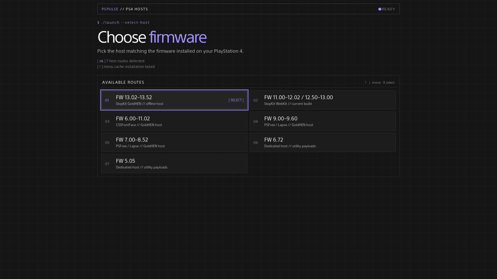

# PSPULSE // HOSTS PARA PS4

<p align="center">
  <strong>Centro de hosts para PS4 sin conexión priorizada con flujos de exploit específicos por firmware e integración de GoldHEN.</strong>
</p>

<p align="center">
  
  
  
  
</p>



```text
$ ./launch --pspulse

[ ok ] 7 rutas de host detectadas
[ ok ] goldhen v2.4b18.12 / v2.4b18.10 preparado
[ ok ] caché sin conexión lista
[ ok ] navegación con mando habilitada
```

PlayStation Pulse es una colección autónoma de páginas estáticas de host para PS4. Un punto de entrada, una elección de firmware, luego el exploit correspondiente y el flujo de GoldHEN — diseñado para alojamiento local, almacenamiento en caché sin conexión y el navegador de PS4.

> [!NOTE]
> Este proyecto está destinado a fines educativos, de preservación e investigación. Su uso corre por su propia cuenta y riesgo. No está afiliado ni respaldado por Sony Interactive Entertainment.

<details>
<summary><b>$ cat contenidos</b></summary>

- [Qué proporciona este proyecto](#qué-proporciona-este-proyecto)
- [Flujos de firmware compatibles](#flujos-de-firmware-compatibles)
- [Cómo funciona el host](#cómo-funciona-el-host)
- [Versiones de GoldHEN](#versiones-de-goldhen)
- [Herramientas de payload](#herramientas-de-payload)
- [Almacenamiento en caché sin conexión](#almacenamiento-en-caché-sin-conexión)
- [Uso del host](#uso-del-host)
- [Sistema de diseño](#sistema-de-diseño)
- [Diseño técnico](#diseño-técnico)
- [Resolución de problemas](#resolución-de-problemas)
- [Seguridad y limitaciones](#seguridad-y-limitaciones)
- [Créditos y atribución](#créditos-y-atribución)

</details>

## Qué proporciona este proyecto

- Un enrutador de firmware unificado estilo terminal en [`index.html`](./index.html).
- Páginas de host sin conexión dedicadas para los firmwares 5.05 y 6.72 de PS4.
- Flujos de host PSFree/Lapse para los firmwares 7.00–8.52 y 9.00–9.60.
- Un flujo de host CSSFontFace UAF para los firmwares 6.00–11.02.
- Un flujo de investigación SlopKit WebKit para los firmwares 11.00–12.02 y 12.50–13.00.
- Recursos de GoldHEN v2.4b18.12 y v2.4b18.10 incluidos en el repositorio donde el host admite ambas compilaciones.
- Operación sin conexión basada en AppCache con archivos de caché y manifiesto específicos por firmware.
- Utilidades de payload específicas por firmware en las ramas del host que las proporcionan.
- Un único sistema visual — estética de terminal oscuro, acento violeta, enfoque adaptado al controlador — en cada selector, página de caché y página de exploit.

## Flujos de firmware compatibles

| # | Firmware | Punto de entrada | Flujo de exploit | GoldHEN | Payloads de utilidad |
|---|---|---|---|---|---|
| 01 | **13.02–13.52** | `1352/index.html` | SlopKit WebKit (GoldHEN) | `v2.4b18.12` | Solo payload original |
| 02 | **11.00–12.02 / 12.50–13.00** | `1300/index.html` | SlopKit WebKit (Lapse / Poops) | `v2.4b18.12` | Solo payload original |
| 03 | **6.00–11.02** | `css/version-selector.html` | CSSFontFace UAF + Lapse/NetCtrl | `stable` o `latest` | Sin menú separado |
| 04 | **9.00–9.60** | `900/version-selector.html` | PSFree + Lapse | Selector de versión | Incluidos |
| 05 | **7.00–8.52** | `700/version-selector.html` | PSFree + Lapse | Selector de versión | Incluidos |
| 06 | **6.72** | `672/index.html` | Host dedicado | Directamente en la página | Incluidos |
| 07 | **5.05** | `505/index.html` | Host dedicado | Directamente en la página | Incluidos |

El selector raíz almacena el firmware seleccionado localmente y enruta a la rama correcta. Utilice siempre el host diseñado para el firmware exacto instalado en la consola.

Protecciones de carga previa: las cadenas 1300 verifican `getuid`/`setuid(0)` después del pivote de espacio de usuario y salen temprano con `ALREADY JAILBROKEN` en lugar de volver a ejecutar el exploit del kernel en un jailbreak activo; las ramas PSFree 700 y 900 consultan el endpoint de estado de GoldHEN (`http://127.0.0.1:9090/status`) durante 1.5 s y omiten el exploit por completo cuando GoldHEN responde. Por lo tanto, volver a abrir un host después de un éxito es seguro por diseño.

## Cómo funciona el host

```text
$ ./launch --select-host

  index.html ──► enrutador de firmware
                     │
      ┌──────────┬──┴─────┬────────┬────────┬────────┬────────┬─────────┐
      ▼          ▼        ▼        ▼        ▼        ▼        ▼         ▼
   FW 13.02  FW 11.00  FW 6.00  FW 9.00  FW 7.00  FW 6.72  FW 5.05
   -13.52    -13.00    -11.02   -9.60    -8.52    host     host
   selector  selector  selector selector selector
      │          │         │        │        │        │         │
      │          │      instalación de caché (elección de compilación de payload)
      ▼          ▼        ▼        ▼        ▼        ▼         ▼
      └──────────┴────────┴───┬────┴────────┴────────┴─────────┘
                              ▼
                 cadena de exploit ──► HEN / GoldHEN + herramientas
```

El proyecto es intencionalmente estático. Las páginas HTML proporcionan la interfaz, los módulos de JavaScript ejecutan la cadena de exploit específica del firmware, los archivos binarios proporcionan los recursos de GoldHEN/parche de kernel/payload, y los archivos AppCache mantienen el flujo seleccionado disponible después de la instalación inicial de la caché.

## Versiones de GoldHEN

El repositorio contiene dos opciones de GoldHEN donde es compatible:

- **GoldHEN v2.4b18.12** — una compilación incluida en el repositorio y expuesta por los selectores.
- **GoldHEN v2.4b18.10** — una compilación anterior incluida en el repositorio.

Las ramas 7.00–8.52 y 9.00–9.60 seleccionan una compilación de GoldHEN a través de su selector de versión y página de caché. La rama CSSFontFace utiliza [`css/version-selector.html`](./css/version-selector.html), que enruta a:

- [`css/latest/index.html`](./css/latest/index.html) para v2.4b18.12;
- [`css/stable/index.html`](./css/stable/index.html) para v2.4b18.10.

## Herramientas de payload

La disponibilidad de payloads es específica para cada firmware.

### Hosts con payloads de utilidad

Dependiendo de la rama seleccionada, las páginas del host proporcionan herramientas como:

- Servidor FTP;
- PS4Debug;
- App2USB;
- Copia de Seguridad y Restauración;
- Habilitar Actualizaciones y Deshabilitar Actualizaciones;
- Instalación de AppCache;
- Bloqueador de Historial;
- Desencriptador PUP;
- Renombrador RIF;
- Corrección PSFree en las ramas PSFree;
- WebRTE en las ramas que lo incluyen;
- Reloj del Kernel en el host de firmware que lo proporciona.

La lista exacta difiere entre 5.05, 6.72, 7.00–8.52 y 9.00–9.60. Los botones de payload cargan el binario seleccionado a través del cargador de payload existente del host y pueden requerir un receptor de payload compatible en la misma red.

### Alcance del host CSSFontFace

La rama CSSFontFace excluye deliberadamente el menú de payloads de utilidad independiente utilizado por las otras ramas del host. El flujo de exploit CSSFontFace es intensivo en memoria por naturaleza, por lo que eliminar herramientas de payload adicionales ayuda a preservar el margen de memoria necesario para un exploit y lanzamiento de GoldHEN más estables. Su interfaz se centra en:

- salida del exploit con líneas de registro codificadas por color (información / error / depuración);
- selección de cadena Lapse o NetCtrl;
- cuenta regresiva para Jailbreak Automático, `Jailbreak` manual y un botón `Reload` para recuperación tras un intento fallido;
- carga automática de la compilación de GoldHEN seleccionada.

La implementación de CSSFontFace aún contiene la etapa binaria interna requerida para completar su flujo de exploit/GoldHEN seleccionado. Esa etapa interna no es un payload de utilidad seleccionable por el usuario y no es equivalente al conjunto opcional de payloads de utilidad excluido de este host.

## Almacenamiento en caché sin conexión

Todas las ramas del host utilizan recursos relativos y almacenamiento en caché de aplicaciones del navegador. Los archivos de caché deben servirse desde las rutas esperadas por sus páginas de entrada; no cambie el nombre ni aplane los directorios de firmware después de la implementación.

| Rama | Flujo de caché |
|---|---|
| **5.05** | `505/cache.manifest` se adjunta a la página del host y la página informa el progreso de la instalación. |
| **6.72** | `672/cache.manifest` se adjunta a la página del host y la página informa el progreso de la instalación. |
| **7.00–8.52** | Seleccione una compilación en `700/version-selector.html`, luego use `cache.html` o `cache5.html` para instalar `PSPulse.cache` o `PSPulse5.cache`. |
| **9.00–9.60** | Seleccione una compilación en `900/version-selector.html`, luego use `cache.html` o `cache5.html` para instalar `PSPulse.manifest` o `PSPulse5.manifest`. |
| **CSSFontFace** | Seleccione una compilación en `css/version-selector.html`; la página `stable` o `latest` elegida usa su propio `cache.manifest` con hashes SHA-256 por archivo. |
| **1300** | Abra `1300/index.html`; la compilación actual se almacena directamente en `1300/` e instala su propio `cache.manifest` automáticamente. |
| **1352** | Abra `1352/index.html` (GoldHEN `v2.4b18.12` para 13.02–13.52); la página instala su propio `cache.manifest` automáticamente, las actualizaciones de caché requieren un toque para recargar. |

Después de la primera instalación exitosa de la caché, cierre y vuelva a abrir el navegador de PS4 cuando la página se lo indique. Si una página aún sirve un diseño o script antiguo, borre los datos del navegador del host y repita la instalación de la caché.

El repositorio también incluye pequeños scripts generadores para reconstruir archivos de caché después de cambios en los recursos. Cada vez que cambie un archivo en caché, regenere el manifiesto/caché correspondiente y verifique que cada ruta relativa referenciada esté disponible desde el host implementado.

## Uso del host

1. Sirva la raíz del repositorio a través de un servidor estático HTTP o HTTPS. No se debe esperar que el navegador de PS4 ejecute el flujo completo desde una URL `file://` no soportada.
2. Abra el [`index.html`](./index.html) raíz en el navegador de PS4.
3. Seleccione el rango de firmware exacto que coincida con la consola.
4. Si la rama seleccionada tiene un selector de versión de GoldHEN, elija **Latest** (Más reciente) o **Stable** (Estable) y espere a que termine la página de caché.
5. En la página del host, espere el mensaje de listo/estado antes de iniciar el exploit.
6. Después de que GoldHEN haya cargado, use solo las herramientas mostradas por esa rama del host.

Para el host CSSFontFace, **Jailbreak Automático** está habilitado por defecto. Después de que la página carga, inicia una cuenta regresiva de cinco segundos y luego ejecuta la cadena automáticamente, o presione `Jailbreak` manualmente en cualquier momento. Durante la cuenta regresiva aún puede seleccionar `Lapse`/`NetCtrl` o desactivar el Jailbreak Automático (la elección persiste en `localStorage`). En la primera visita, la cuenta regresiva espera hasta que la instalación de AppCache se asiente — la cadena de exploit pesada nunca se ejecuta sobre una descarga de caché incompleta. Una caché recién instalada recarga la página una vez, luego la cuenta regresiva se reinicia; una actualización descubierta en segundo plano se aplica en el siguiente inicio. Cuando el navegador está sin conexión, una falla en la actualización del manifiesto se trata como no fatal siempre que la caché instalada siga siendo válida, por lo que el host en caché aún se inicia automáticamente.

La página CSSFontFace almacena la cadena seleccionada en `localStorage` bajo `exploitChain` y la preferencia de Jailbreak Automático bajo `autoJb`. El selector raíz y los selectores de GoldHEN también mantienen sus valores seleccionados localmente para que el navegador pueda preservar la última elección entre cargas de página.

## Sistema de diseño

Cada página — selector raíz, selectores de versión, instaladores de caché y hosts de exploit — comparte un lenguaje visual construido para un televisor visto desde un sofá y un motor WebKit antiguo:

- **Paleta** — fondo casi negro `#151515`, paneles `#1c1c1c`/`#242424`, un solo acento violeta `#a294ff`, error `#ff9b9b`, advertencia `#e1bd72`.
- **Estética de terminal** — tipografía monoespaciada, iniciadores `$ ./launch`, líneas de arranque `[ ok ]`, separadores `//`, rutas numeradas.
- **Legible a distancia** — títulos de ruta grandes (19–24 px), encabezados de página sobredimensionados, nada por debajo de 12 px.
- **Prioridad al controlador** — cada elemento interactivo es un elemento enfocable real con un doble anillo de enfoque (`2px fondo + 4px acento`); navegación con teclas de flecha con alternativas legacy `keyCode` para compilaciones antiguas de PS4 WebKit.
- **Cero sobrecarga** — sin frameworks, sin fuentes o imágenes externas, sin transiciones, sin keyframes, sin `backdrop-filter`; solo HTML estático, CSS en línea y pequeños scripts ES5.
- **Legibilidad del registro** — salida de exploit codificada por color en el host CSSFontFace: información en acento, errores en rojo, depuración atenuada.

## Diseño técnico

### Selector raíz

La página raíz es un enrutador de host estilo terminal en lugar de un menú desplegable. Admite interacción con puntero y navegación por teclado/controlador, almacena `selectedFirmware` y enruta a la rama de host correspondiente.

### Mantenimiento de AppCache

AppCache es una tecnología de navegador obsoleta, pero es parte del modelo de entrega sin conexión del host. Trate los archivos de caché como artefactos generados: después de cambiar un recurso HTML, JavaScript, binario o parche, actualice la lista/hash de caché correspondiente y pruebe las rutas de primera carga y carga en caché por separado.

## Resolución de problemas

### Se carga la página incorrecta o una versión antigua

Borre los datos del sitio del navegador de PS4 para el host, cierre y vuelva a abrir el navegador, luego comience desde el selector raíz. Confirme que el archivo de caché de la rama seleccionada contenga las rutas de recursos relativas actuales.

### La caché nunca termina

Asegúrese de que el repositorio se sirva a través de HTTP/HTTPS, el manifiesto tenga la configuración MIME correcta en el servidor, y cada archivo listado sea accesible en la ruta relativa exacta. Una AppCache obsoleta puede sobrevivir a las actualizaciones normales; borre los datos del sitio antes de volver a intentarlo.

### El exploit no se completa

Verifique el firmware de la consola y la rama seleccionada, cierre las pestañas del navegador no relacionadas y vuelva a intentarlo desde un estado de navegador limpio. En la página CSSFontFace, el inicio automático se ejecuta por sí solo después de que la caché se asienta; después de cualquier falla, cierre y vuelva a abrir completamente el navegador (y reinicie la consola si se repite) en lugar de volver a ejecutar la cadena sobre un estado sucio. La fiabilidad del exploit puede variar según la memoria del navegador, el estado de la caché y las condiciones de la consola.

### Memoria agotada durante el exploit ("not enough RAM")

La cadena CSSFontFace solo tiene éxito cuando su heap spray se asigna correctamente; esto es una lotería de memoria, no un error de interfaz, y varios intentos fallidos seguidos son una variación normal. Para maximizar la tasa de éxito:

1. Instale la caché primero, luego **cierre completamente el navegador de PS4** (no solo navegue a otra página).
2. Vuelva a abrir el navegador, abra **solo** la página del host y no toque nada mientras se ejecuta.
3. Deje que la cuenta regresiva de inicio automático se ejecute por sí sola; no mueva el cursor durante la ejecución.
4. Después de cualquier falla, cierre y vuelva a abrir completamente el navegador; una recarga de página por sí sola no borra un estado sucio del kernel.
5. Si una cadena sigue fallando con memoria agotada en su firmware, pruebe la otra cadena (`Lapse` vs `NetCtrl`); sus patrones de asignación difieren.

Aumentar los tiempos de espera no ayuda: la memoria agotada ocurre *durante* el spray en sí, y la página es de solo ~10 KB frente a decenas de megabytes de asignaciones de exploit. No modifique los tamaños de spray o los conteos de intentos; son constantes upstream ajustadas por investigadores.

### El navegador de PS4 se congela

JavaScript no puede recuperar de manera fiable un proceso de navegador que ha dejado de responder. Cierre y vuelva a abrir el navegador de PS4, luego cargue el host correspondiente nuevamente. Evite agregar bucles repetidos de reintentos o recargas; pueden aumentar la inestabilidad.

### Un payload de utilidad no responde

Espere hasta que el host informe que el flujo de exploit/GoldHEN está listo. Confirme que el host seleccionado realmente proporcione la utilidad solicitada, que la PS4 y el receptor de payload estén en la red esperada, y que el receptor esté escuchando en el puerto requerido. La rama CSSFontFace no proporciona botones de payload de utilidad independientes.

## Seguridad y limitaciones

- Utilice solo el host diseñado para el firmware exacto de la consola.
- No interrumpa la consola mientras se ejecuta un exploit, carga de GoldHEN, payload u operación del sistema.
- Mantenga una ruta de recuperación segura y copias de seguridad actuales antes de usar utilidades relacionadas con copias de seguridad, restauración o el sistema.
- No utilice páginas de exploit para acceso a PSN u otros servicios en línea.
- No asuma que un payload es inofensivo simplemente porque está incluido localmente; revise lo que hace cada utilidad antes de cargarla.
- El flujo CSSFontFace es especialmente sensible a la memoria disponible del navegador; excluir payloads de utilidad opcionales es una compensación de estabilidad intencional.
- La rama 11.00–12.02 / 12.50–13.00 es una ruta de investigación sin garantía de estabilidad; 12.03–12.49 no tienen un error funcional upstream.
- Ningún host puede garantizar resultados idénticos en cada consola, compilación de navegador, estado de caché o configuración de red.

## Créditos y atribución

```text
$ whoami

Autor ............. BlackArch
Comunidad .......... PlayStation Pulse (Telegram)
Servidores de juegos ....... NodePlay
```

**Autor:** [BlackArch](https://t.me/sudoBlackArch)<br>
**Comunidad:** [PlayStation Pulse](https://t.me/PlayStation_Pulse)<br>
**Servidores de Juegos Premium:** [NodePlay](https://nodeplay.net/)

> Para cualquier uso de los materiales o archivos, los enlaces al autor [BlackArch](https://t.me/sudoBlackArch) y al grupo de Telegram [PlayStation Pulse](https://t.me/PlayStation_Pulse) deben permanecer en todas las páginas.

---

```text
$ exit

PSPULSE // colección de hosts para ps4 sin conexión
```

## Actualización de caché sin conexión

Las páginas de compilación anterior ahora cargan el goldhen10.bin existente en lugar del ausente goldhen5.bin. Su blob de Git coincide con css/stable/src/payload.bin. El propietario del proyecto confirma: goldhen10.bin es b18.10, goldhen.bin es b18.12, css/stable/src/payload.bin es b18.10, y css/latest/src/payload.bin es b18.12. Las identidades de blob de Git confirman de manera independiente que estas copias son idénticas dentro de cada compilación. La compatibilidad del dispositivo aún requiere pruebas de hardware. No se modificaron binarios.

Almacene en caché el menú en línea, luego instale cada caché de host/versión requerida en línea. Pruebe la navegación del menú y la carga del host con la red deshabilitada. Un menú en caché no instala cada caché de host.

### Nomenclatura de payloads

| Ruta | Compilación GoldHEN |
| --- | --- |
| `*/goldhen.bin` | b18.12 |
| `*/goldhen10.bin` | b18.10 |
| `css/latest/src/payload.bin` | b18.12 |
| `css/stable/src/payload.bin` | b18.10 |
| `1300/payload.bin` | b18.12 (blob de Git idéntico a latest) |

El sufijo `5` en los nombres de archivos históricos (`cache5.html`, `index5.html`, `loader5.js`, `PSPulse5.*`) identifica la ruta de compilación anterior, ahora b18.10; no es una etiqueta de versión b18.5. La entrada legacy del selector `v2.4b18.5` se normaliza a `v2.4b18.10` antes del almacenamiento y la navegación. Las anotaciones históricas de PS4-HEN en las notas de diagnóstico de firmware no determinan qué binario se carga; el actual `1352/goldhen.bin` coincide con b18.12.